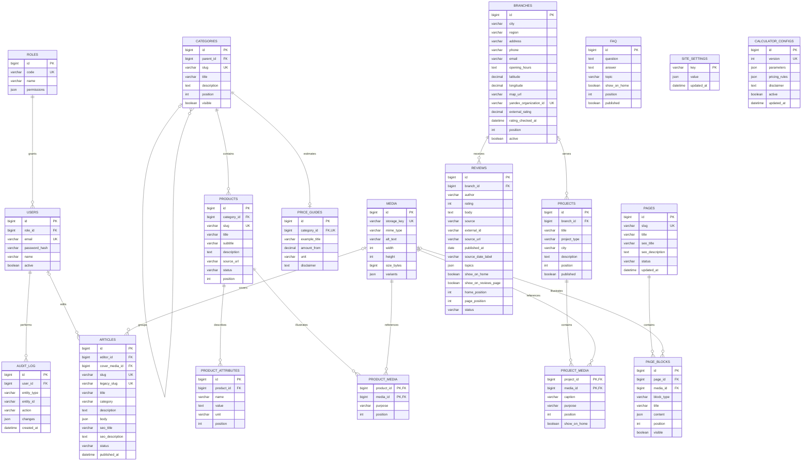

# База сайта «Спектр» для админки

Проектная ER-модель для переноса текущих HTML/JSON/JS-данных в управляемую базу. База и сервер админки пока не созданы. Заявки и сотрудники CRM остаются в Битрикс24 и не входят в эту модель.

## Что редактируется

| Раздел админки | Таблицы |
|---|---|
| Страницы и порядок блоков | `pages`, `page_blocks` |
| Каталог: направления и подкатегории | `categories` с родительской категорией |
| Названия, описания и характеристики товаров | `products`, `product_attributes` |
| Примерные цены по направлениям | `price_guides`: один пример на категорию |
| Фото, видео и их облегчённые версии | `media` |
| Статьи | `articles` |
| Примеры работ, галерея и «до / после» | `projects`, `project_media` |
| Филиалы, контакты и оценки | `branches` |
| Отзывы и отдельные подборки для главной/страницы отзывов | `reviews` |
| Вопросы и ответы | `faq` |
| Логотипы, темы, общие контакты, меню и настройки интеграций | `site_settings` |
| Размеры, профили и правила расчёта калькулятора | `calculator_configs` |
| Доступ в админку и журнал изменений | `users`, `roles`, `audit_log` |

## Ограничения модели

- PK — первичный ключ; FK — внешний ключ; UK — уникальное значение. Необязательные связи допускают NULL.
- Категория товара — конечная подкатегория. Вложенность восстанавливает полное направление, например «Окна ПВХ → REHAU».
- В `price_guides.amount_from` используется точный десятичный тип, не float. Сумма неотрицательна. Единица измерения хранится отдельно.
- Оценка отзыва — целое число от 1 до 5. Внешний идентификатор отзыва уникален в пределах источника, если он известен.
- Две подборки отзывов независимы. Изменение `show_on_reviews_page` и `page_position` не меняет главную.
- `project_media.purpose` различает обычную фотографию, «до» и «после». Для одного проекта допускается не более одного изображения каждого из типов «до» и «после».
- JSON используется для упорядоченного содержимого блоков и статей, а также конфигурации. Он валидируется по типу блока. Файлы не встраиваются в JSON: для вложенных изображений статей и блоков потребуются отдельные таблицы связей с `media` при детализации редактора.
- `media.variants` содержит пути, размеры и форматы производных версий одного файла. Сами фото и видео хранятся в файловом/объектном хранилище, в БД — их метаданные.
- Связь `audit_log.entity_type/entity_id` — ссылка журнала на разные типы объектов, а не внешний ключ. Записи журнала сохраняются после удаления контента.
- Публикации используют статусы `draft`, `published`, `archived`. Для справочников и блоков применяются флаги видимости.
- Активна только одна версия конфигурации калькулятора. Изменение расчётных правил публикуется новой версией.
- Секреты интеграций хранятся на сервере в защищённых настройках, не в общедоступном `site_settings` и не в коде сайта.

Это основа для проектирования админки. В текущем статическом сайте серверная БД не подключена; для сохранения изменений из админки понадобится backend/API.
